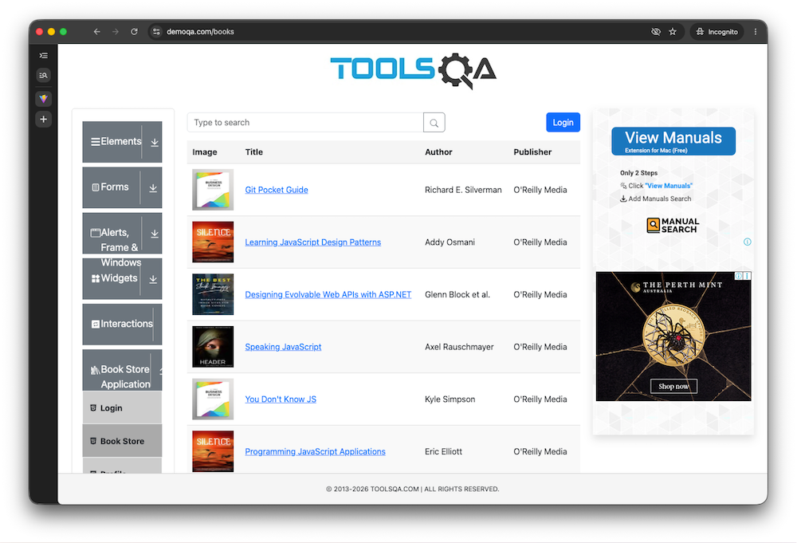

# QE Technical Test - Playwright (API + UI)

## What is it

Automated tests for a two-part Quality Engineering exercise:

- **Task 1 - Web UI**: the demoqa [Book Store](https://demoqa.com/books) site - login, table search, book details. Playwright + TypeScript, Page Object pattern.
- **Task 2 - REST API**: the [Restful-Booker](https://restful-booker.herokuapp.com/) API - health, auth, full booking CRUD plus negative paths. Same framework, service-object pattern.

Goals:  demonstrate coding style and the techniques  selected for this assessment, ability to adhere to developing code using
design patterns and techniques to make code & test data maintainable; ability to develop code that can be tied to Continuous Delivery infrastructure.

Both suites share one package and run as three Playwright projects: `auth-setup`, `api`, `ui`.

The framework is intentionally small. The goal is to demonstrate most important concepts and patterns, sound design choices and a working CI/CD foundation, not to build infrastructure that the assessment doesn't require.



## Quick start

Prerequisites: Node.js LTS (CI runs Node 24).

```
git clone https://github.com/MaksimZinovev/assessment-qe-technical-2610
cd assessment-qe-technical-2610
./scripts/init.sh    # .env from .env.example + npm ci + Playwright browsers + git hooks
./scripts/verify.sh  # biome → tsc → all 24 test runs (19 scenarios; ui re-runs on Firefox)
```

## Usage

- `./scripts/verify.sh` - full gate: lint → typecheck → all tests
- `npm run test-api` - Restful-Booker suite only
- `npm run test-ui` - Book Store suite only
- `npm run test-smoke` - smoke subset (`--grep @smoke`): ping, auth token, one standard create, tc-006 login
- `TEST_ENV=env1 npm run test-api` - run in a named environment (Linux/Mac; same prefix works with any other script)
- `npx playwright test tests/api/booking-crud.spec.ts` - single spec example
- `npx playwright show-report` - open the HTML report from the last run
- `npx playwright test --list` - all test titles without running (useful map into the tables below)
- `npx biome check --write .` - lint + autofix formatting

### CI (GitHub Actions)

- `ci.yml` - manual trigger: repo → **Actions → ci → Run workflow** → project (all/api/ui) + optional grep filter. Runs the same biome → tsc → Playwright chain (retries: 1 per config) and uploads the HTML report on every run.
- `secrets.yml` - automatic on push/PR: gitleaks full-history scan. The pre-commit hook (wired by `init.sh`) scans staged changes the same way when gitleaks is installed locally.

### Environment configuration

Base URLs and the environment name live in `.env` and are loaded by dotenvx into the Playwright config, which assigns each project its `baseURL`, validates the values, and prints the active environment at startup. Tests and Page Objects use relative URLs only - changing the target environment never touches test code. Real secrets would be stored outside version control or encrypted with dotenvx; `npx dotenvx run -f .env.uat -- npm run test-api` is the same mechanism with a dedicated env file.

## Task notes

Requirements are the task's own wording; the comment points at the file and place in the repo that implements it. Full test titles: `npx playwright test --list`.

### Task 1 - Web UI automation (Book Store)

| No | Requirement | Comment |
| --- | --- | --- |
| 1 | Pick an open-source automation framework | `playwright.config.ts` - one config, four projects; framework choice reasoning in docs/design-decisions.md |
| 2 | Develop automated tests for the site | `tests/ui/` - 5 tests, tc-002…tc-006 in specs + `tests/auth.setup.ts` (tc-001) |
| 3 | Registration may be left out | Deliberately out of scope; the journey starts at login: `tests/ui/login.spec.ts` → tc-006 |
| 4 | Design patterns and maintainable code & test data | `pages/` = Page Objects, `support/fixtures.ts` = fixture DI, `data/ui/*.json` = typed JSON test data |
| 5 | Code tied to Continuous Delivery | `.github/workflows/ci.yml` - one dispatch run proves lint + types + tests green and stores the HTML report |
| 6 | AI assistance noted in README | AI assistance section below, detail in `docs/AI-assistance.md` |
| 7 | Show coding style and techniques | `docs/design-decisions.md` records each choice with its reasoning; agent workflow rules in `AGENTS.md` |

### Task 2 - REST API automation (Restful-Booker)

| No | Requirement | Comment |
| --- | --- | --- |
| 1 | Suite using the endpoints from the API docs | `support/booking-client.ts` → covers ping, POST /auth, GET /booking, GET/PUT/PATCH/DELETE /booking/:id, POST /booking - all eight documented endpoints exercised (ids list by `tests/api/booking-crud.spec.ts` → booking list test) |
| 2 | Data-driven approach, appropriate data format | `data/api/booking-create.json` + `data/api/booking-negative.json` → cases imported as typed JSON (`with { type: "json" }`), one spec file per concern |
| 3 | Positive and negative scenarios | `tests/api/booking-create.spec.ts` (4 positive rows) vs `tests/api/booking-negative.spec.ts` (5 cases: schema violations, missing id, unauth 403) |
| 4 | Values flow between endpoints | `tests/api/booking-crud.spec.ts` → booking lifecycle test: id from POST reused by GET/PUT/PATCH/DELETE; token arrives from POST /auth via the `token` fixture |
| 5 | Patterns for maintainability, robustness, repeatability | `support/fixtures.ts` → dependency-injected `bookingClient` + `token`; `support/booking-client.ts` → typed service object, specs stay thin |
| 6 | Clear, concise assertion descriptions | Every `expect()` carries its message; see `tests/api/booking-crud.spec.ts` (e.g. "delete success should return 201 Created") |
| 7 | AI automates 1 endpoint; output + annotations in repo | `docs/AI-assistance.md` (populated by Maksim) |

Submission (both tasks): the requirement is a public repository with runnable code and instructions - Quick start above plus `scripts/init.sh`.

## Dependencies

| Package | Why |
| --- | --- |
| `@playwright/test` | Test runner, UI browser automation, API request contexts (browsers via `init.sh`) |
| `typescript` | Static typecheck; data files validated at compile time, not just runtime |
| `@biomejs/biome` | One tool for lint + format, with its native Playwright lint domain |
| `@dotenvx/dotenvx` | Loads `.env` ahead of the Playwright config (`import "@dotenvx/dotenvx/config"`) |

No runtime dependencies - the suite never ships anything; everything above is dev-only.

## Project structure

```text
assessment-qe-technical-2610/
├── .agents/skills/                  # vendored agent skills: ponytail, slop-scan, unslop
├── .github/workflows/
│   ├── ci.yml                       # dispatch-only test workflow (project + grep inputs)
│   └── secrets.yml                  # gitleaks full-history scan on push/PR
├── .githooks/pre-commit             # gitleaks protect --staged; wired by scripts/init.sh
├── .gitleaks.toml                   # allowlists committed .env (public demo creds)
├── .auth/                           # generated storageState (gitignored)
├── AGENTS.md                        # mandates: ponytail, slop-scan, grilling convention
├── INTENT.md                        # the user's original intent notes
├── README.md                        # this file
├── agents/
│   └── progress.md                  # harness state log, updated at every milestone gate
├── data/
│   ├── api/                         # booking-create.json, booking-negative.json
│   └── ui/                          # book-detail.json, search-cases.json
├── docs/
│   ├── AI-assistance.md             # how AI tooling was used and validated
│   ├── design-decisions.md          # every design choice, with its reasoning
│   └── harness-overview.md          # how the repo steers AI agents
├── pages/
│   ├── book-store-page.ts           # books table: open, search, open a book
│   └── login-page.ts                # demoqa login form
├── scripts/
│   ├── init.sh                      # bootstrap: .env, npm ci, browsers, git hooks
│   └── verify.sh                    # quality gate: biome → tsc → playwright
├── support/
│   ├── booking-client.ts            # typed Restful-Booker service (all endpoints)
│   ├── demoqa-credentials.ts        # throwaway sandbox password, not a secret
│   └── fixtures.ts                  # dependency-injected bookingClient + token
├── tests/
│   ├── api/                         # health, booking-create, booking-crud, booking-negative
│   ├── ui/                          # search, book-detail, login
│   └── auth.setup.ts                # auth-setup project → .auth/state.json
├── biome.json                       # lint + format, native Playwright domain
├── package.json / package-lock.json
├── playwright.config.ts             # projects: auth-setup, api, ui, ui-firefox
├── tsconfig.json                    # resolveJsonModule: true
├── .env                             # committed: public demo creds only
└── .env.example                     # template init.sh copies when .env is missing
```

How the repo steers AI agents on this build: `docs/harness-overview.md`.

## Test coverage

**19 scenarios · 8 files · 4 Playwright projects**

The same 5 UI scenarios re-run on Firefox as the `ui-firefox` project (same cookie-based auth, so `npm run test-firefox` covers it) - 24 runs in total.

- **Authentication Setup** (1)
  - API user creation → UI login → session persistence.
- **API** (13)
  - **Health & Auth** (2) - Ping endpoint, authentication token.
  - **Booking Creation** (4) - Standard, long names, zero price, future dates.
  - **Booking List** (1) - GET /booking returns a non-empty ids index.
  - **CRUD Lifecycle** (1) - POST → GET → PUT → PATCH → DELETE.
  - **Negative Tests** (5)
    - Invalid payloads: missing price, missing dates, empty body.
    - Non-existent booking ID.
    - Unauthorized mutations (403).
- **UI** (5)
  - **Search** (3) - JavaScript, Git Pocket, no-match query.
  - **Book Details** (1) - Verify fields after opening a book.
  - **Authentication** (1) - Session restore, logout, re-login.

## AI assistance

How AI tooling was used and validated: [docs/AI-assistance.md](docs/AI-assistance.md). Please also see section below "AI agent harness"

## AI agent harness

> the software infrastructure that enables a language model to perform tasks by providing tools, memory, execution environments, and guardrails. It essentially transforms a model into an operational agent capable of completing real-world tasks rather than just responding to prompts.

The build was also an agent-harness exercise: AI agents did the implementation, and the repository carries their rules and memory.

- [AGENTS.md](AGENTS.md) - standing agent rules: minimal-code mandate, quality gate before every commit, tool hierarchy.
- [agents/progress.md](agents/progress.md) - agent state log: milestone briefs, checkpoints, decisions; work survives session boundaries.
- [.agents/skills/](.agents/skills/) - this repo's vendored skills ([agentskills.io](https://agentskills.io) spec):
  - [ponytail](https://github.com/DietrichGebert/ponytail) - forces the smallest code that works; no speculative layers.
  - [slop-scan](https://github.com/modem-dev/slop-scan)- detects AI-associated slop in JS/TS code before commits.
  - [unslop](https://github.com/cursor/plugins/blob/main/pstack/skills/unslop/SKILL.md) - cuts AI tells from any writing.
- [grill-me](https://github.com/mattpocock/skills/blob/main/skills/productivity/grilling/SKILL.md)- a relentless interview that sharpens a plan or design before implementation.
- [playwright](https://github.com/MaksimZinovev/pi-agent-config/blob/main/skills/playwright/SKILL.md) - my own skill, Playwright-specific guidance (locators, fixtures, config) applied while writing the suites.
- [ego-browser](https://github.com/citrolabs/ego-lite/blob/main/skills/ego-browser/SKILL.md) - Chromium browser operated by users and AI agents for browser automation, QA, and app review.
- [learn-harness-engineering](https://github.com/walkinglabs/learn-harness-engineering) - harness engineering beginner tutorial, from 0 to 1.
- [scripts/verify.sh](scripts/verify.sh) + [ci.yml](.github/workflows/ci.yml) - the gate agents check their work against before reporting; GitHub Actions re-runs it independently on dispatch.

## Design decisions

Short list of the choices a reviewer will notice first; full reasoning in `docs/design-decisions.md`, and the framework-design checklist — how would you design a good test automation framework — is at [docs/framework-design.md](docs/framework-design.md).

- Data-driven tests via typed JSON imports - shape drift is a compile error, no loader code.
- API suites stay thin: a typed service object (`BookingClient`) plus a small fixture layer.
- No BDD, no wrapper layers beyond Page Objects, native Playwright diagnostics, `test.describe` grouping only for multi-test specs.
- Credentials are public demo values (published in Restful-Booker's docs); the env-file pattern is demonstrated as it would be used for real secrets.

Framework knowledge: [Playwright documentation](https://playwright.dev), [Playwright Solutions](https://playwrightsolutions.com) patterns, lint via [Biome's Playwright domain](https://biomejs.dev/). Prior public builds reused selectively: [assessment-qa-engineer-nsw-revenue](https://github.com/MaksimZinovev/assessment-qa-engineer-nsw-revenue) (Playwright API suite), [automation-bookstore-yaml](https://github.com/MaksimZinovev/automation-bookstore-yaml) (Azure DevOps multi-stage pipeline), [tau-advanced-playwright](https://github.com/MaksimZinovev/tau-advanced-playwright) (Advanced Playwright course).

## Logging

- API client lines: `[booking] POST /booking (Crud Journey) → 200` from `console.info` in `support/booking-client.ts` - plain terminal runs stay debuggable.
- In-test steps: `test.step()` names the phases in every spec; the CRUD journey reads as get → PUT → PATCH → delete + verify gone.
- Report attachments: create-echo payloads attached as JSON in `booking-create` and `booking-crud` (payloads only - no credentials or tokens).
- Traces are captured on first retry, screenshots on failure, and both ride inside the HTML report that CI stores as an artifact.

The reasoning (why no logging library, what was rejected): docs/design-decisions.md → "Diagnostics: native Playwright".
